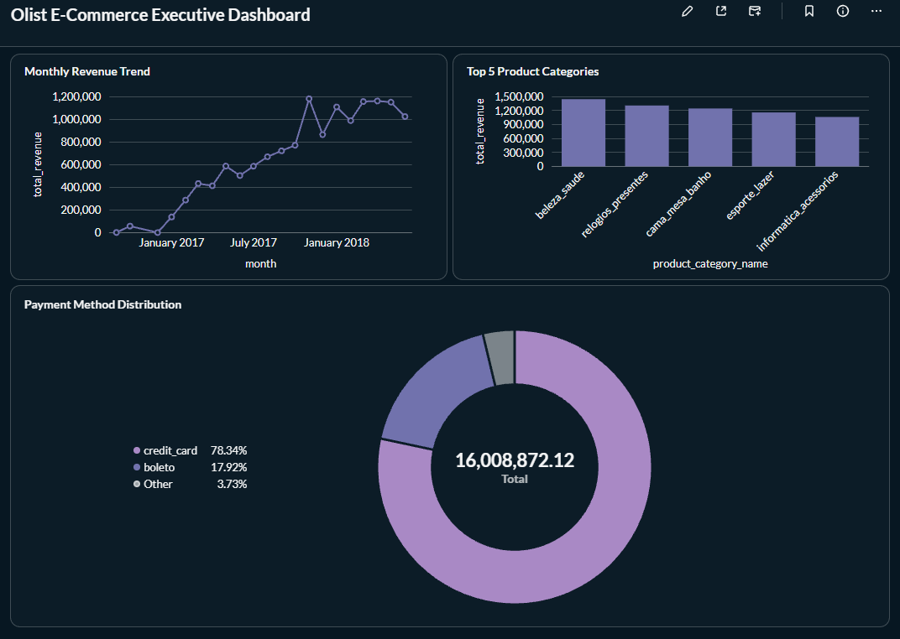

# Olist Analytics Engineering



Production-style analytics engineering project built on the 
[Olist Brazilian E-Commerce dataset](https://www.kaggle.com/datasets/olistbr/brazilian-ecommerce). 
Demonstrates end-to-end ELT with dbt, PostgreSQL, and Prefect — including 
staging layer design, star schema modeling, data quality tests, and 
orchestrated ingestion.

## Why This Project

Most dbt portfolio projects stop at "it runs". This project focuses on 
the questions that matter in production:

- How do you handle schema drift from upstream sources?
- When does a dbt test fail vs. error, and why does the distinction matter?
- How does grain affect fact table design as new sources arrive?
- What does "production-ready" mean beyond green tests?


## Stack

| Layer | Tool |
|---|---|
| Ingestion | Python (pandas, SQLAlchemy) |
| Warehouse | PostgreSQL |
| Transformation | dbt-core + dbt-postgres |
| Orchestration | Prefect 3.x (Phase 3) |
| Data Quality | dbt tests + source freshness |
| CI/CD | GitHub Actions (Phase 3) |

## Project Structure
```text
olist-analytics/
├── ingestion/ # CSV → PostgreSQL raw schema
├── dbt_project/
│ ├── models/
│ │ ├── staging/ # 1:1 with sources, minimal transforms
│ │ └── marts/ # star schema (dim_, fact_)
│ └── tests/ # custom data tests
├── data/ # local only, gitignored (see Data Setup)
└── .github/workflows/ # CI (phase 3)
```

## Data Setup

CSV files are not committed to this repo (too large). Download from 
[Kaggle](https://www.kaggle.com/datasets/olistbr/brazilian-ecommerce) 
and place in `data/`:
```text
data/
├── olist_orders_dataset.csv
├── olist_customers_dataset.csv
├── olist_order_items_dataset.csv
├── olist_products_dataset.csv
├── olist_sellers_dataset.csv
├── olist_payments_dataset.csv
├── olist_reviews_dataset.csv
├── olist_geolocation_dataset.csv
└── product_category_name_translation.csv
```

Then run:

```bash
python ingestion/load_csv_to_postgres.py
cd dbt_project && dbt build
```

## Roadmap

- [x] **Phase 1: Staging Layer** (Orders, Customers)
- [x] **Phase 2: Star Schema** (Add Products, Order Items, Dims, Facts)
- [ ] **Phase 3: Complete Marts & CI/CD** (Sellers, Payments, GitHub Actions)
- [ ] **Phase 4: Advanced Modeling & AI Agent** (Snapshots, AI schema generation)

Progress is tracked via pull requests — each phase is a PR with design decisions and trade-offs documented.

## Design Decisions

*(Updated as phases complete. See PRs for full context.)*

### Why sources, not seeds, for large CSVs?

dbt seeds reload the full file on every build and don't support incremental loading. Files >1k rows belong in an ingestion script and are declared as sources.

### Why staging views, marts tables?

Staging models are cheap transformations (renames, casts) — views avoid redundant storage. Marts are queried by BI tools and benefit from materialization (tables).

### Why TRUNCATE CASCADE instead of DROP TABLE in ingestion?

When re-running the Python ingestion script, a standard `DROP TABLE` fails because dbt views depend on the raw tables. We use a conditional `TRUNCATE ... CASCADE` to clear data safely without breaking the downstream dbt dependencies.

### Why Fact Table grain is at `order_item` level?

One order can contain multiple items. To analyze product categories and freight values accurately, the `fact_orders` table must be at the `order_item` grain (112,650 rows), joined to `dim_products` and `dim_customers` (Star Schema).

## License

MIT — see [LICENSE](LICENSE).

## Author

**Wahyudi Robby Sutanto** — Analytics Engineer
- LinkedIn: [LinkedIn](https://www.linkedin.com/in/wahyudirs/)

